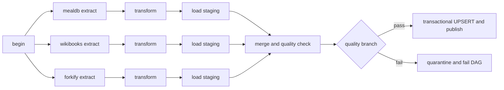

# Recipe Atlas

ระบบรวบรวมสูตรอาหารนานาชาติและวิเคราะห์วัตถุดิบที่ใช้

รายวิชา Big Data Platform and Analytics 02739452 · โชติณัช โสภาแปง · 6621600828 · ลำดับที่ 5

Repository: https://github.com/Chotinat01/02739452-5-6621600828

## สถานะที่ตรวจได้จริง

ดึงข้อมูลจริงได้ 290 สูตรหลังรวมด้วยกฎตัดซ้ำแบบระมัดระวัง จาก TheMealDB 100 สูตร, Wikibooks 180 สูตร และ Forkify 10 สูตร ผ่าน Airflow → PostgreSQL → dashboard แล้ว รายละเอียดการทดสอบอยู่ใน `evidence/` และ `docs/TESTING.md`

**ดึงข้อมูลจริงครบสามแหล่งแล้วโดยไม่ต้องใช้ API key** มี TaskGroup ขนาน, UPSERT, การทนแหล่งล่ม, การตัดซ้ำข้ามแหล่ง, quality branching และหน้าสถานะ pipeline สำหรับโบนัส ผลทดสอบระดับ 3 ต้องดูหลักฐานรอบล่าสุดใน `evidence/verification.json` ไม่ถือว่ามีการรับรองคะแนนจากอาจารย์

## แหล่งข้อมูลและการใช้งาน

| แหล่ง | วิธีดึง | ฟิลด์ | ข้อจำกัด |
|---|---|---|---|
| [TheMealDB](https://www.themealdb.com/api.php) | REST API `search.php?s=` และค้นอักษรต้นตามเอกสาร | ชื่อ ประเภท ประเทศ วัตถุดิบ | ใช้ educational key `1` ที่ผู้ให้บริการเผยแพร่ จำกัดเก็บไม่เกิน 100 สูตร |
| [Wikibooks Cookbook](https://en.wikibooks.org/wiki/Category:Recipes) | requests + BeautifulSoup จาก HTML | ชื่อ ส่วนผสม หมวด และ URL ต้นฉบับ | ตรวจ robots.txt ก่อนเสมอ หน่วงอย่างน้อย 1.1 วินาทีต่อ host เก็บ HTML cache 24 ชั่วโมง |
| [Forkify](https://forkify-api.jonas.io/) | GET `/api/v2/recipes?search=pizza` แล้วอ่านรายละเอียดตาม id | ชื่อ วัตถุดิบ เวลาปรุงที่ API รายงาน | GET ไม่ต้องใช้ key จำกัด 10 สูตร เก็บ cache 1 ชั่วโมง ใช้ 11 คำขอต่อรอบที่ไม่มี cache; ผู้ให้บริการจำกัด 100 คำขอ/ชั่วโมง |

ไม่มี Selenium ไม่มีข้อมูลผู้ใช้หรือผู้รีวิว ไม่เก็บข้อมูลส่วนบุคคลจากต้นทาง หน้า Wikibooks ที่ไม่มี Ingredients จะถูกบันทึกว่าข้าม ไม่สมมติวัตถุดิบขึ้นเอง ต้นทางบางรายการไม่มีประเทศหรือเวลาปรุง เก็บเป็น NULL

Wikibooks เป็นเนื้อหาที่ผู้ใช้ร่วมเขียน ให้เครดิตผ่าน URL ของแต่ละสูตรและปฏิบัติตาม [เงื่อนไขอนุญาตของ Wikibooks](https://en.wikibooks.org/wiki/Wikibooks:Copyrights) (CC BY-SA ตามที่ต้นทางระบุ) ควรตรวจสิทธิ์ก่อนนำไปเผยแพร่ต่อในบริบทอื่น

## สิ่งที่ต้องมี

- Docker Desktop ใช้ Linux containers และ Docker Compose v2
- แนะนำ RAM ให้ Docker อย่างน้อย 4 GB และอินเทอร์เน็ตสำหรับ build กับดึงข้อมูล
- Windows PowerShell สำหรับสคริปต์ช่วยติดตั้ง หรือสร้าง `.env` เองบนระบบอื่น

## เริ่มใช้งานบน Windows

```powershell
git clone https://github.com/Chotinat01/02739452-5-6621600828.git
cd 02739452-5-6621600828
powershell -ExecutionPolicy Bypass -File scripts/setup.ps1
docker compose up -d --build
docker compose ps -a
```

`setup.ps1` สร้างรหัสผ่านและ encryption keys แบบสุ่มใน `.env` และไม่เขียนทับไฟล์ที่มีอยู่ หากใช้ Linux/macOS ให้คัดลอก `.env.example` เป็น `.env` แล้วกำหนดรหัสผ่านจริงและ Fernet key ที่ถูกต้องให้ครบ ค่า database URLs ต้องตรงกับรหัสผ่านที่ตั้ง

- Airflow: http://localhost:8080 เข้าด้วย `AIRFLOW_ADMIN_USER` และ `AIRFLOW_ADMIN_PASSWORD` จาก `.env` ในเครื่องตนเอง
- Dashboard: http://localhost:8501
- PostgreSQL อยู่เฉพาะเครือข่าย Docker ไม่เปิด port ให้ภายนอก

Dashboard ตั้งธีมสว่างใน `.streamlit/config.toml` และให้สีพื้นกับข้อความของ widget ใช้ธีมเดียวกัน กราฟใช้พื้นขาวและตัวอักษรเข้มโดยตรง หากอัปเดตจากรุ่นเดิมให้รัน `docker compose up -d --build --no-deps dashboard` แล้วรีเฟรชเบราว์เซอร์

เปิด DAG `international_recipe_pipeline` แล้ว Unpause และ Trigger DAG หรือใช้คำสั่ง:

```powershell
docker compose exec airflow-scheduler airflow dags unpause international_recipe_pipeline
docker compose exec airflow-scheduler airflow dags trigger international_recipe_pipeline
```

การรันครั้งแรกอาจใช้เวลาหลายนาทีเพราะ Wikibooks มีการหน่วงคำขอและตรวจ robots หน้า dashboard จะรอจน quality gate ผ่านและเผยแพร่สำเร็จ กด **Refresh from PostgreSQL** เพื่อดึงผลล่าสุด

ทั้งสามแหล่งใช้ได้โดยไม่ต้องสมัคร API key เพิ่ม ถ้าแก้จากเวอร์ชันเดิมที่ใช้ Spoonacular ให้อัปเดตโค้ดและ `docker compose up -d --build` แล้ว Trigger DAG ใหม่ ชื่อกลุ่มที่สามจะเป็น `forkify` ประวัติรอบเดิมยังคงอยู่ในฐานข้อมูล

Forkify เป็น API สำหรับโครงการเรียน ไม่ใช่ผู้จัดทำสูตรต้นฉบับทั้งหมด จึงเก็บ endpoint URL ที่ดึงจริงเป็นที่มา และตัดชื่อ publisher กับข้อมูลผู้ใช้ออกจาก payload เวลาปรุงเป็นค่าที่ API รายงาน ไม่ได้ยืนยันจากการปรุงจริง หากเคยจองโดยระบุ Spoonacular ให้ผู้ใช้แก้แหล่งที่สามตามข้อความใน `docs/TOPIC_RESERVATION.md`

## โครงสร้าง DAG



สาม TaskGroup ไม่มี dependency ข้ามกัน จึงทำงานขนานด้วย LocalExecutor แต่ละแหล่งแยก extract → transform → load ข้อมูล HTML ขนาดใหญ่อยู่ใน volume ส่วน XCom เก็บเพียง path/summary แหล่งที่ network ล่มจะมีสถานะ `unavailable` ทำให้ merge ใช้แหล่งที่เหลือได้ task สีเขียวจึงไม่ได้หมายความว่าแหล่งนั้นดึงสำเร็จ ต้องตรวจหน้าสถานะควบคู่

## Schema และกฎข้อมูล

| ตารางหรือ view ใน schema `recipes` | หน้าที่ |
|---|---|
| `runs` | เวลา สถานะ settings และ quality report ราย run |
| `source_status` | สถานะรายแหล่ง จำนวนที่ดึง/ผ่าน/ไม่ผ่าน และรายละเอียดข้อผิดพลาด |
| `staging` | ข้อมูลที่ผ่าน validation แยก run/source/source_id |
| `quarantine` | รายการที่ไม่ผ่าน validation พร้อมเหตุผล |
| `canonical` | สูตรที่เคยเผยแพร่ ใช้ canonical_id เป็น primary key และ UPSERT |
| `publication` | pointer ไปยัง run ที่เผยแพร่สำเร็จล่าสุด |
| `current_recipes` | เฉพาะสูตรของ publication ปัจจุบัน สำหรับ dashboard |

Fingerprint ใช้ SHA-256 ของชื่อสูตรที่ normalize รวมกับส่วนผสม raw ที่เรียงแล้ว รวมสูตรต่างแหล่งเฉพาะเมื่อข้อมูลตรงกันตามกฎนี้ เก็บ provenance ของทุกแหล่ง ชื่อเหมือนแต่ปริมาณต่างกันแยกสูตร กฎนี้ไม่ใช่ fuzzy deduplication จึงอาจมีสูตรคล้ายกันที่ไม่ถูกรวม แต่ลดการทำสูตรคนละแบบหาย มี unit test ข้อมูลจำลองเพื่อพิสูจน์กรณี cross-source duplicate โดยไม่อ้างว่าข้อมูลจริงพบ duplicate แน่นอน

Quality gate ต้องมีอย่างน้อย 100 สูตรไม่ซ้ำ มีอย่างน้อยหนึ่งแหล่งใช้งานได้ invalid records ไม่เกิน 20% มีผลของทุก source group และไม่ได้เปิด fault injection ถ้าไม่ผ่าน จะบันทึก `quality_failed` แล้วไป `quarantine_and_stop` ซึ่งจงใจทำ DAG failed โดยไม่เปลี่ยน publication เดิม

การเผยแพร่ทำ UPSERT และเปลี่ยน pointer ใน transaction เดียว แถวจาก run เก่าที่ไม่พบใน run ใหม่จะไม่แสดงใน `current_recipes` แต่เก็บในประวัติ canonical การรันซ้ำด้วยข้อมูลเดิมไม่เพิ่มจำนวนแถว

Dashboard ใช้ `recipe_reader` ซึ่งมี SELECT เฉพาะ schema recipes และอ่าน PostgreSQL โดยตรง มี KPI กราฟวัตถุดิบ กราฟแหล่งข้อมูล ตาราง ตัวกรองชื่อ/วัตถุดิบ/ประเภท/แหล่ง และหน้าประวัติ pipeline กราฟวัตถุดิบเป็นชื่อที่ normalize แบบระมัดระวัง ยังอาจมีคำใกล้เคียงแยกกัน

## ทดสอบและแก้ปัญหา

```powershell
docker compose exec airflow-scheduler python -m pytest /opt/airflow/project/tests -q
docker compose exec airflow-scheduler airflow dags list-import-errors
docker compose logs --tail 100 airflow-scheduler
docker compose logs --tail 100 airflow-init
```

ตัวอย่าง Trigger DAG with config ใน UI:

```json
{"fail_sources": ["mealdb"]}
```

```json
{"force_quality_failure": true}
```

สั่ง `{"refresh": true}` เพื่อข้าม cache แล้วเก็บสดอีกครั้ง เฉพาะเมื่อจำเป็น ลดการรบกวนต้นทาง Forkify จำกัด 100 คำขอต่อชั่วโมง จึงไม่ควรสั่ง refresh ซ้ำถี่ ๆ โดยเฉพาะเมื่อมี retry อ่านขั้นตอนและผลจริงใน `docs/TESTING.md`

หาก Docker ติดต่อไม่ได้ ให้เปิด Docker Desktop และตรวจ `docker info` หากพอร์ตชน ให้แก้ `AIRFLOW_PORT` หรือ `DASHBOARD_PORT` ใน `.env` แล้วรัน Compose ใหม่ หากขึ้นหน้าเว็บแต่ยังไม่มีข้อมูล ให้ดูสถานะ run และสาเหตุใน Pipeline status

## เตรียมส่ง

- Repo ต้องเป็น public และมี commit ก่อนเวลาที่อาจารย์กำหนด ผู้ใช้ตรวจ visibility และส่ง Classroom เอง
- ใช้ repo ชื่อ `02739452-5-6621600828` ตามลิงก์ที่ผู้ใช้ให้ ส่วนโฟลเดอร์เดิมชื่อ `02739452-05-6621600828` ไม่มีผลต่อระบบ
- PDF ใช้ `5_6621600828_summary.pdf` ตามลำดับที่ใน repo หากอาจารย์กำหนดสองหลักให้เปลี่ยนเป็น `05_6621600828_summary.pdf`
- PDF ระบุเฉพาะระดับที่ทดสอบได้จริง มี Graph/Grid/dashboard จากระบบจริง และปัญหาที่พบจริง
- ก่อน commit ตรวจ `.env` ไม่อยู่ในรายการ staged และห้าม commit `data/` หรือ logs ที่อาจมีข้อมูล credential
- แก้แหล่งที่สามในโพสต์จองจาก Spoonacular เป็น Forkify ตาม `docs/TOPIC_RESERVATION.md` เพื่อให้ตรงกับระบบที่ส่ง

## โครงไฟล์

`dags/` DAG · `pipeline/` extractor/transform/DB/tasks · `web/` dashboard · `scripts/` setup/ตรวจระบบ/สร้างรายงาน · `tests/` unit และ PostgreSQL integration tests · `evidence/` ผลทดสอบและภาพหน้าจอ · `output/pdf/` PDF สรุป

สร้าง PDF ใหม่ได้ด้วย Python ที่ติดตั้ง `requirements-report.txt` แล้วรัน `python scripts/make_summary.py` บน Windows ที่มีฟอนต์ Tahoma สคริปต์ใช้ภาพใน evidence และต้องมี verification.json ที่ผ่านแล้ว การเปลี่ยนภาพหรือเพิ่มแหล่งข้อมูลต้องตรวจรายงานให้ตรงกับผลใหม่ก่อนส่ง

เอกสารอ้างอิง: [Airflow Docker](https://airflow.apache.org/docs/apache-airflow/2.10.4/howto/docker-compose/index.html), [TheMealDB API](https://www.themealdb.com/api.php), [Forkify API](https://forkify-api.jonas.io/), [Wikibooks robots](https://en.wikibooks.org/robots.txt)
